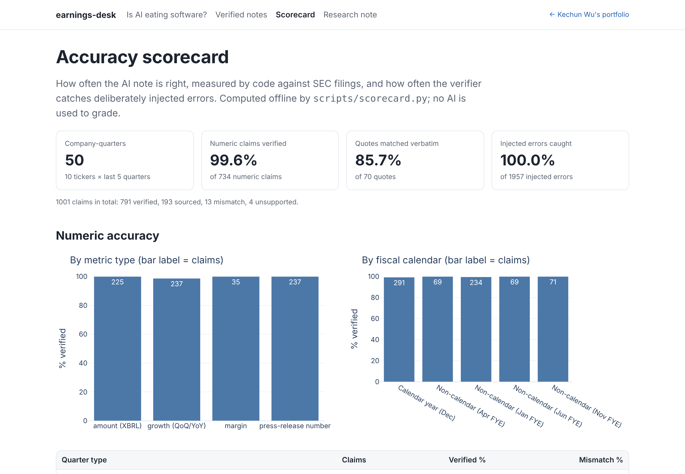
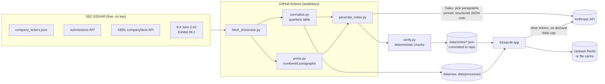

# earnings-desk

**AI earnings notes on any US-listed company, where every number is checked by code against the SEC's own structured data.**

**Live app: https://earnings-desk.streamlit.app/**

Commercial tools (Hebbia, AlphaSense, Fiscal.ai) already summarize filings. The open problem is trust: language models misstate numbers, mix up periods and invent quotes, so analysts re-check everything by hand. This project writes a structured earnings note from SEC filings, then a deterministic verifier (plain code, no AI) checks every claim. It also measures how often a note can be trusted, and shows where it fails.

Theme of the landing page: **"Is AI eating software? What the filings say."** In 2026 software stocks sold off on fears that AI would replace SaaS, even as earnings estimates rose. The app lines up ten companies' own filings so anyone can check the story against reported numbers.


## What's in the app

| Page | What it shows |
|---|---|
| **Is AI eating software?** | 10 companies aligned by calendar quarter: revenue growth, GAAP operating margin, growth vs free-cash-flow margin, RPO growth, and code-generated findings. Charts only. |
| **Verified note** | An AI-written note for any company-quarter. Every claim is marked ✓ verified, ⚠ mismatch (with the real value), ◦ sourced, or ✗ unsupported, and expands to its source: the XBRL concept, filing and formula, or the press-release paragraph. |
| **Company numbers** | Any ticker: the last 8 quarters of key metrics, QoQ/YoY growth, margins, charts and a link to every source filing. No AI. |
| **Scorecard** | Measured accuracy over 50 company-quarters, error-injection catch rates, a hand-graded sample, and "where it fails and why". |

Showcase tickers: CRM, NOW, ADBE, SNOW, DDOG, NVDA, MSFT, PLTR, AI (C3 AI), NDAQ. Any other ticker is fetched live from the SEC.




## Scorecard headline

<!-- SCORECARD:START -->
Measured on **50 company-quarters** (10 tickers, 1001 claims):

- **99.6%** of 734 numeric claims verified against XBRL (0.4% mismatched).
- **85.7%** of 70 quotes matched the press release word for word.
- **100.0%** of 1957 injected errors caught by the verifier (value +5% 491/491, value −5% 491/491, wrong unit 188/188, wrong period 493/493, QoQ/YoY swapped 234/234, quote word changed 60/60).
- Failures: quote paraphrased, not quoted (10), rounding at the boundary (3), number not in cited paragraph (2), nothing checkable (bad metric, period or citation) (2).

_Generated by `scripts/scorecard.py`; details on the Scorecard page._
<!-- SCORECARD:END -->

## Architecture



## How verification works

1. **Inputs.** The normalized XBRL metrics for the current, prior and year-ago quarter, with growth and margins precomputed in code. The earnings press release is split into numbered paragraphs (`P1`, `P2`, …), with each table as one paragraph.
2. **Writing.** `claude-haiku-5-5` picks the relevant paragraphs. `claude-sonnet-5-5` writes a JSON note in four sections, with the format enforced by a schema: *What happened · What changed vs last quarter / last year · Management's explanation and guidance · What to watch next quarter*. Every sentence is a claim: `{text, claim_type, metric, period, value, unit, source: {type, ref}}`.
3. **Verification** (`earnings_desk/verify.py`, plain code):
   - **Numeric claims** are recomputed from XBRL: the base value, QoQ/YoY growth from the two underlying values, or a margin. The number *as written in the sentence* must be a correct rounding of the filed value ("$11.3B" ±$0.05B, "11%" ±0.5pp), in the right unit, for the right period, with the right direction ("down 5%"). Numbers with no XBRL equivalent (non-GAAP figures, guidance, cRPO) must appear in the cited paragraph.
   - **Quote claims**: the words inside quotation marks must be an exact substring of the cited paragraph. Only typography and whitespace are normalized.
   - **Qualitative claims** must cite a real paragraph and contain no numbers that the paragraph lacks. They are marked "sourced, not machine-verifiable".
4. **No silent fixes.** Failed claims are shown with the real value and the reason. They are never dropped and never sent back to the model. Stored notes are re-verified on every load, so a verifier fix applies to old notes too.

**Scorecard method** (`earnings_desk/scorecard.py`):
- Accuracy by metric type, fiscal calendar and Q4-vs-other.
- **Error injection**: each verified claim is corrupted (value ±5%, wrong unit, wrong period, QoQ↔YoY, one word changed in a quote) and re-checked.
- A random 20-claim sample is exported to `data/scorecard/hand_grade.csv` for grading by hand; the Scorecard page reads the grades back.

## Data rules (the traps handled up front)

- **Periods come from each fact's own start/end dates**, not the `fy`/`fp` fields, which describe the *filing*.
- **Fiscal vs calendar labels.** NVDA, CRM and SNOW end their fiscal year in late January, MSFT in June, ADBE in November (52/53-week years) and C3 AI in April. Every quarter carries its fiscal label (`FY2027 Q2`), its calendar label (`CY2026 Q2`, by the quarter's midpoint) and its period-end date.
- **Q4 is derived** as full year − 9-month YTD, since 10-Ks have no Q4 figure. Cash-flow quarters are derived from YTD totals. Both are flagged ᵈ with the formula. Diluted EPS is never derived, because share counts differ.
- **Concept fallbacks.** For example, `RevenueFromContractWithCustomerExcludingAssessedTax` → `Revenues` → … (see `earnings_desk/concepts.py`). The concept actually used is recorded for every value.
- **Restatements.** The most recently filed value is used and the original is kept (ʳ).
- **Limited coverage.** Banks, lenders, insurers, 20-F/40-F and IFRS filers get an honest "limited coverage for this filer type" message instead of numbers. Recent IPOs get a warning.

## Limitations

- **No earnings-call transcripts.** They aren't freely available, so management commentary comes only from the press release.
- **Qualitative claims (◦) are not machine-verifiable.** Code can check that a claim cites a real paragraph, not that it's a fair reading of it, or that the note leaves nothing important out.
- **The verifier checks against XBRL as filed.** A tagging error by the company would pass. The hand-graded sample is the independent check.
- **Some metrics are partial or missing for some filers.** Some companies tag only the current portion of deferred revenue (ᵖ). Some don't report S&M or R&D separately (e.g. NVDA reports SG&A). NDAQ revenue is gross of transaction-based expenses, so its margins aren't comparable.
- **Quarter-end mismatches.** An earnings 8-K is matched to a quarter by filing date (within 75 days of quarter end). Unusual filing patterns can leave a quarter without a note.
- **Model choice for on-demand notes.** Notes for non-showcase tickers use `claude-haiku-5-5` to keep costs low. Showcase and scorecard notes use `claude-sonnet-5-5`.
- **Not investment advice.** No ratings, price targets or valuation.

## Run locally

```bash
pip install -r requirements.txt
```

```bash
export SEC_USER_AGENT="Your Name your@email.com"
```

```bash
streamlit run app.py
```

```bash
pytest -q
```

Tests run in about a second on saved SEC samples (`tests/samples/`) with canned model outputs. They never call the Anthropic API. To refresh data or write notes locally, run `python -m scripts.fetch_showcase CRM` and then `ANTHROPIC_API_KEY=... python -m scripts.generate_notes CRM`.

## Deploy (Streamlit Community Cloud)

1. Go to share.streamlit.io, sign in with GitHub, then **Create app** → **Deploy a public app from GitHub**.
2. Set Repository `KC31415/earnings-desk`, Branch = the repo's default branch (rename it to `main` under Settings → Branches if you like), Main file `app.py`.
3. Under **Advanced settings**, choose Python 3.11 and paste the secrets below.

| Secret | Where | Required |
|---|---|---|
| `SEC_USER_AGENT` | Streamlit + GitHub Actions | yes: `"Name email@example.com"` |
| `ANTHROPIC_API_KEY` | Streamlit (on-demand notes) + GitHub Actions (showcase/scorecard notes) | yes for notes |
| `UPSTASH_REDIS_REST_URL`, `UPSTASH_REDIS_REST_TOKEN` | Streamlit | optional: cache for on-demand notes (otherwise a local file, reset on redeploy) |
| `NOTE_DAILY_CAP` | Streamlit | optional: max new on-demand notes per day (default 5) |

GitHub Actions secrets live under repo Settings → Secrets and variables → Actions. The weekday data refresh only runs on the default branch.

## Repository layout

```
earnings_desk/   sec.py (client), concepts.py, normalize.py, analytics.py, press.py,
                 note.py (prompt + LLM), verify.py, store.py, notes_service.py, scorecard.py, landing.py, takes.py
pages/           home, note, company, scorecard (Streamlit)
scripts/         fetch_showcase.py, generate_notes.py, scorecard_batch.py, scorecard.py, make_test_samples.py
data/raw/<T>/    submissions.json, companyfacts.json (mapped concepts, values verbatim), press/*.htm
data/notes/      verified notes (JSON), one per (ticker, earnings 8-K accession)
data/scorecard/  results.json, claims.csv, hand_grade.csv
takes/           Analyst's take for each showcase ticker (written by hand; hidden while empty)
tests/           unit tests: synthetic calendars, real SEC samples, verifier, scorecard
```
